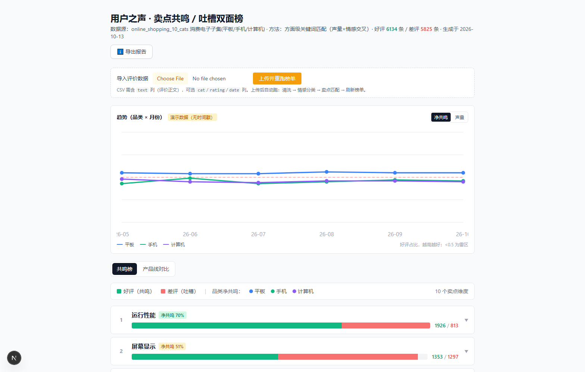
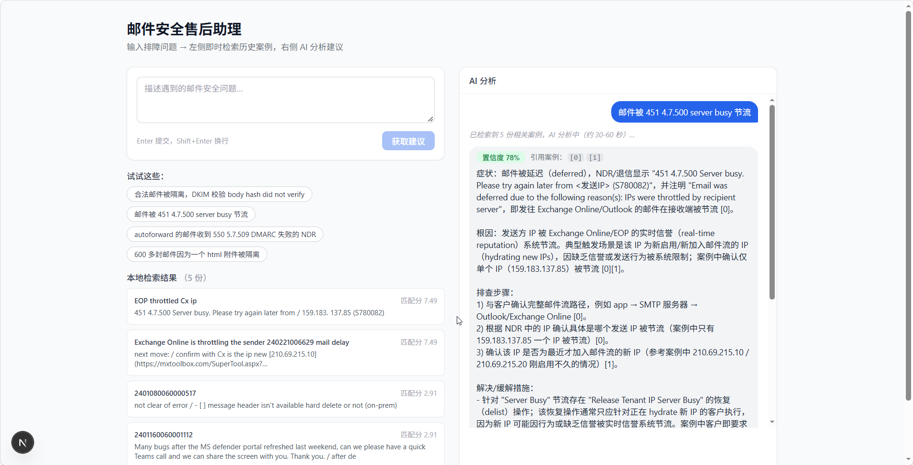
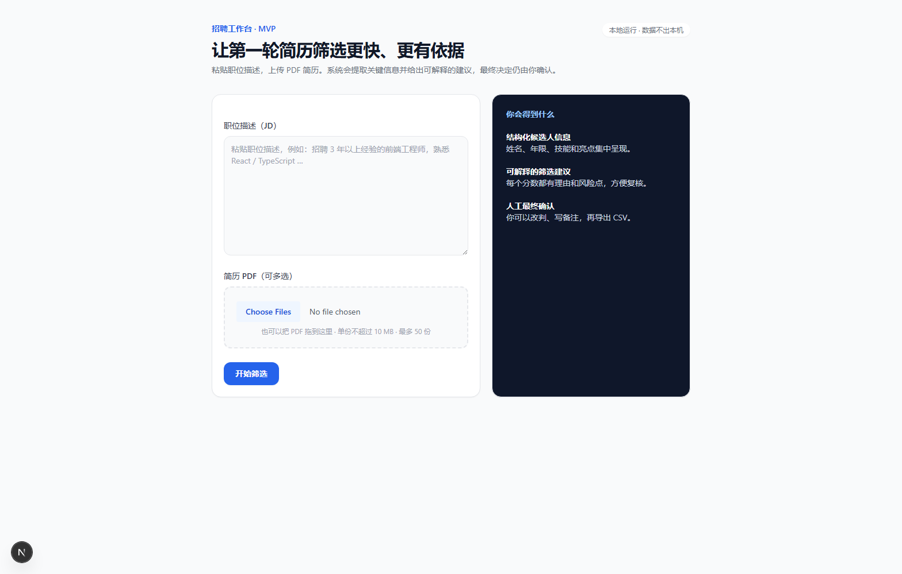

# MarketingOrPMP_VibeCoding

面向消费电子企业业务场景的 **VibeCoding 方案库与可跑产品集**：用 agentic coding 工具（Claude Code / Codex）为市场营销（GTM）、研发项目管理（IPD）、招聘与人才管理三大业务域设计并交付可生产的 Agent 系统，沉淀工程化方法让业务专家能自助开发简单 Agent。

**已交付三个可跑产品**（非 PPT 方案——每个都能 `npm run dev` 起真实界面，附真实数据与评测证据）：

---

## 🎧 用户之声 VoC · 卖点共鸣榜

> ABSA（方面级情感分析）驱动：不只看"用户提到了什么"（声量），更看"用户是夸还是骂"（情感）。GTM 团队看主打哪些卖点，IPD 团队看哪些是雷区排改进优先级。



- **共鸣/吐槽双面榜**：10 卖点维度各拆好评(共鸣)/差评(吐槽)/净共鸣度——单看声量榜看不到的洞察（屏幕声量第 2 但差评追平好评，不能当卖点；续航 854 条差评是最大痛点）
- **产品线对比矩阵**：卖点×品类净共鸣，横向看跨产品线差异，纵向看某线卖点 vs 雷区
- **可重复数据接入 + 可导出报告**：CSV 上传自动重跑；页头一键下载 Markdown 报告给老板/客户
- **市场及格线 4/4 全达成**（对标 $99/月卖家工具 Helium10/Shulex 的 table stakes）

数据：开源 16241 条真实电商评价（好评 6134/差评 5825）→ [产品文档](apps/voc-analysis/README.md) · `cd apps/voc-analysis && node node_modules/next/dist/bin/next dev -p 3010`

---

## 🛡️ 邮件安全排障聊天助手

> 能上手玩的可交互排障助手：输入邮件安全故障，左侧秒级检索 107 份真实脱敏历史 case，右侧 AI 给结构化排障分析（症状/根因/排查步骤/解决措施 + 置信度 + 引用 case 编号），可多轮追问——对案例没有的信息，诚实说"我不知道"而不是编。



- **即时检索 + AI 分析**：提交后左侧立即列出 top-5 相关案例（带匹配分），右侧 AI 给置信度+引用的结构化建议
- **诚实拒答**：案例库没有的信息（如某团队联系方式），AI 明说"案例中没有记录，我无法编造"——检索增强的可靠性在界面上可直接验证
- **评测可辩护**：recall@5=100%、MRR=0.979（2026-10-08 实测），附 titleWeight=0 消融证真 + 三阶段评测收敛 + 诚实边界声明

底层是「词法检索+标题索引→LLM生成→评委打分」RAG 闭环 → [产品文档](apps/support-assistant/README.md) · `cd apps/support-assistant && npm run dev`

---

## 📄 简历初筛 Agent

> AI 初筛，人做最终决定。LLM 批量完成「读简历→抽取→打分→分档」，HR 在审核队列复核、改判、备注，一键导出 CSV。不全自动拒人是招聘场景的业务红线。



- **批量初筛**：粘贴 JD + 拖入几十份 PDF，LLM 逐份抽取（姓名/年限/技能/亮点）并按 JD 打分分档（recommend/hold/reject + 理由 + 风险点）
- **人工复核改判**：AI 只给建议，人做最终决定——审核队列支持过滤/搜索/排序，详情 drawer 改判档位+备注
- **诚实处理异常**：扫描件等抽不出文本的标 `needs_manual` 不强行打分
- **工程严谨**：22 单元测试 + 端到端冒烟（真实 PDF 解析 + mock LLM 依赖注入不调真实 API）

本地运行、数据不出本机 → [产品文档](apps/resume-screening/README.md) · `cd apps/resume-screening && npm run dev`

---

## 这个仓库还有什么

**① 系统方案库（17 项）** —— 三大业务域可 vibe 的系统清单，含数据来源、核心 AI 环节、工程量及依据：

| 业务域 | 系统（⭐ 为需求方点名） | 工程量 |
|---|---|---|
| 市场营销 | ⭐达人自动筛选建联、⭐产品客服培训、竞品情报监控、用户之声 VoC、GTM 内容工厂、达人寄样跟踪、营销素材库 | 1–5 天 |
| 研发项目管理 | ⭐会议→行动项自动看板、IPD 阶段门评审助手、研发周报、缺陷/客诉分诊、项目风险雷达 | 1–5 天 |
| 招聘人才 | 简历初筛、候选人 outreach、面试题+纪要分析、人才库激活、入职引导 Bot | 0.5–2 天 |

**② 工程加速方法论** —— 需求不精简前提下的四条工程加速路径（多 Agent 并行 / 模型分层 / Worktree 隔离 / 规约驱动开发），附外部研究佐证与代价对比。上面三个产品就是这些方法的落地：模型分层路由（简历初筛）、规约驱动开发（VoC 的 spec 先行）。

**③ 母模板** —— `template/` 可复用骨架（数据接入→LLM批处理→人工审核→看板/导出）+ 《Agent 工程化手册》。做一个新系统按手册五步：复制 template → 定义 schema → 写领域 prompt → 配置队列列 → 接数据源。

## 目录

```
template/                      # 母模板 + 《Agent 工程化手册》(README.md)
  src/{db,llm,lib,components}  # 可复用骨架：数据接入→LLM批处理→人工审核→看板/导出
apps/
  resume-screening/            # 简历初筛 Agent（Web UI，可 npm run dev）
  support-assistant/           # 邮件安全排障聊天助手（可交互对话 UI + RAG，107 真实 case）
  voc-analysis/                # 用户之声 VoC 卖点共鸣榜（市场及格线 4/4，最成熟实例）
    pipeline/                  #   Python 管道：清洗→LLM情感→关键词卖点匹配→榜单/趋势/报告导出
    src/                       #   Next.js Web UI：双面榜 + 趋势卡 + 产品线对比 + 数据接入 + 报告下载
docs/
  RECORDS.md                                        记录台账（所有关键产出登记）
  analysis/
    2026-09-16-vibecoding-catalog-and-acceleration.md   系统清单 + 工程量 + 加速方案（核心文档）
  specs/   plans/                                   各系统 spec 与实施计划
.omp/AGENTS.md                                      项目约定
```

## 配置

LLM provider 默认 Volcengine Ark（Coding Plan），在 `.env.local` 配 `VOLCENGINE_API_KEYwinomp=<key>`；切 Anthropic 则设 `LLM_PROVIDER=anthropic` + `ANTHROPIC_API_KEY`。详见各 app `.env.example` 与 `template/README.md`。

## 三条业务红线

1. 外发内容（建联话术、候选人沟通）必须人工点头发送
2. 招聘 Agent 不做全自动拒人，人做最终决定
3. 抓取类功能优先用导出数据，注意平台 ToS
