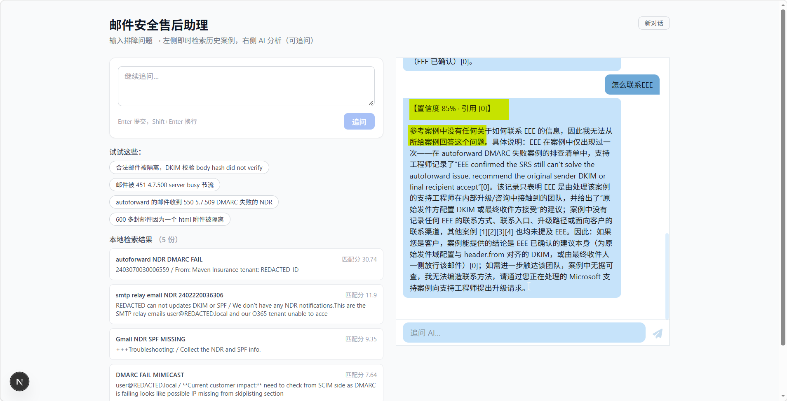
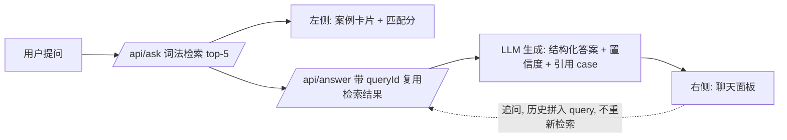

# support-assistant —— 邮件安全排障聊天助手

> 一个能上手玩的可交互排障助手：输入邮件安全故障描述，左侧秒级检索 107 份真实脱敏历史 case，右侧 AI 给出结构化排障分析（症状/根因/排查步骤/解决措施 + 置信度 + 引用 case 编号），还支持多轮追问——对案例里没有的信息，它诚实说"我不知道"，而不是编。
>
> 底层是「词法检索 + 标题索引 → LLM 生成 → 评委打分」的 RAG 最小闭环，也是 `template/src/rag/` 泛化骨架的第一个语料实例。

---

## 界面


*主界面：输入"邮件被 451 4.7.500 server busy 节流"→ 左侧检索出相关 case（带匹配分）→ 右侧 AI 分析给出置信度 78%、引用 [0][1] 和结构化排查步骤。*



*追问态：继续问"怎么联系 EEE"→ AI 置信度 85%，并明说"案例中没有联系方式，我无法编造联系方法"——宁可拒答也不编造。*

---

## 核心能力：你能用它做什么

- **提问**：用自然语言描述邮件安全故障（隔离/退信/节流/DKIM/DMARC/自动转发失败…），或直接点 4 个预设示例问题一键体验。
- **即时检索**：提交后左侧**秒级**列出 top-5 相关历史案例（词法检索，不等 LLM），每条带匹配分和正文摘要，先看原始材料。
- **AI 分析**：右侧聊天面板随后给出结构化排障建议，头部标注**置信度百分比 + 引用的 case 编号**，每条结论可回溯到具体案例原文。
- **多轮追问**：同一对话里继续深挖（追问不重新检索，历史自动带入上下文）。想换话题点"新对话"重置。
- **诚实拒答**：案例库没有的信息（比如某个团队的联系方式），AI 明确说"案例中没有记录，我无法编造"——检索增强的可靠性不是口号，是你在界面上能直接验证的行为。

## 怎么跑（Quick Start）

前置：`D:/Learning_ob_vault` 里已有 107 个 `#case` 排障文件（含 `templates` 子目录，脚本自动排除）。

**第 1 步：脱敏 + 产出语料（Python，唯一真相源）**

```bash
cd apps/support-assistant
python scripts/desensitize.py
```

产出 3 个文件（`data/`）：
- `corpus.jsonl` —— 107 行，`{id, title, text}` 脱敏全文
- `chunks.jsonl` —— by-file 单 chunk（当前无生产消费者，evaluate 内存重新 chunk）
- `desensitization-report.md` —— 20 类 PII 脱敏统计（明文密码 1 / GUID 340 / 客户邮箱 219 / 租户 65 …）

**第 2 步：启动聊天界面**

```bash
cd apps/support-assistant
# 参考 .env.example 配置 LLM_PROVIDER 与对应 API key（DeepSeek / OpenAI / 火山 Ark 任选）
npm run dev   # 打开 http://localhost:3000
```

本目录已有独立 `node_modules`（Next.js 15 + React 19 + @chatscope 聊天组件）。

**第 3 步（可选）：复现检索评测数字**

```bash
cd apps/support-assistant
npx --no-install tsx scripts/evaluate.ts --corpus data/corpus.jsonl --topK 5
npx --no-install tsx scripts/ablate-title.ts   # 标题权重消融对照
```

## 怎么工作



- **检索**（`src/rag/retrieve.ts`）：词法打分 + 标题索引，秒级返回，不等 LLM。
- **生成**（`src/rag/generate.ts`）：语料无关 core——prompt 硬性约束"只用给定上下文回答，没有就明说，引用来源 id"；领域语汇全部集中在 `src/llm/domain.ts`（角色 + 输出 schema：`answer / cited_case_ids / confidence`）。
- **会话**（`src/app/api/answer/route.ts`）：sessionId → 历史 + contexts 暂存内存，追问时把对话历史拼进 query，core 零改动。
- **core 与领域数据的边界**：`chunker / retrieve / generate / judge / eval` 五份导入闭包零领域依赖（已泛化进 `template/src/rag/`，diff 仅注释泛化、语义等价）；`goldset / judge-calibration` 引用具体 case 主题，是领域数据，留在本目录。换语料 = 只换 `domain.ts` 一个文件，`domain.gtm.ts` 是第二实例的实物证明。

## 设计取舍

1. **检索与生成拆成两个接口**：`/api/ask` 先返回本地结果（秒级），`/api/answer` 再异步跑 LLM（reasoning 模型约 30–60 秒，前端显示"分析中"）。用户先看到可验证的原始案例，再等 AI 综合——信任建立顺序是"证据在前，观点在后"。
2. **诚实拒答靠 prompt 契约，不靠后处理**：生成 prompt 明确"只用上下文回答，没有就明说"，拒答行为是模型契约的一部分，配合置信度一起暴露给用户，而不是兜底文案。
3. **换语料只换一个文件**：所有领域语汇（角色、schema）收敛在 `domain.ts`，RAG 五件套 core 零领域依赖——这套原型同时验证了"RAG 骨架可泛化"这个工程假设。
4. **脱敏单点收敛**：10 步规则（按泄露风险降序）只活在 `desensitize.py`，TS 侧不二次脱敏，避免两处规则漂移。

## 效果与证据

**检索评测**（2026-10-08 实测，`scripts/evaluate.ts`）：

```
recall@5: 100.0%
MRR: 0.979
24/24 queries hit a gold doc in top-5
```

**消融证真**（`scripts/ablate-title.ts`）：`titleWeight=0`（纯正文）下 recall@5 仍 100%——检索质量来自正文，不是靠 title=文件名 的循环命中。

**评测方法为什么可辩护**：
- **gold set 内容锚定**（`src/rag/goldset.ts`）：query = 自然用户症状描述；gold 判定 = 正文 symptom/cause/resolution 含答案，每条 `reason` 引用正文原文作证。
- **三阶段收敛**：迭代 #1 发现 title 权重让 recall 假 100%（循环论证）→ 迭代 #2 杀掉循环（query 脱文件名）→ 迭代 #3 剔除"无答案"的低信号 case。详见 `D:/projects/knowMyself/docs/verification/2026-10-08-rag-iteration-*.md`。
- **judge 校准**（`scripts/judge-calibrate.ts` + `src/rag/judge-calibration.ts`）：20 条校准集，用真实 LLM 串行跑 faithfulness 校准。

**脱敏审计**（`data/desensitization-report.md`）：20 类 PII，明文密码 1 / GUID 340 / 客户邮箱 219 / 租户 65，零泄露验证通过。

### 诚实边界（不假装解决）

recall@5 = 100% 依然**可能**是更隐蔽的同源偏差：query 由我自己照正文症状撰写，可能从"标题循环"滑向"正文循环"。公平评测的正解是用**独立 query 源**（真实用户提问语料，或 LLM 只看 symptom 提纲、不看正文时独立生成 query）。当前数字的诚实边界是"symptom 形式的 query + 正文检索能找回全部有答案的 case"，**不对外宣称召回率 100%**。

## 局限与扩展

- **会话存内存**：session 挂 `globalThis`，dev 重启即失效；生产化需要持久化会话存储。
- **词法检索的天花板**：同义改写、跨语言 query 会掉召回；骨架预留了向量检索的替换位（`retrieve` 是纯函数，换实现不动调用方）。
- **chunks.jsonl 暂无生产消费者**：evaluate 在内存重新 chunk；若接 TS 直读 raw md 的场景可复用早期 `ingest.ts` / `corpus.ts`（见下），否则可删。
- **扩展路径**：换语料 = 换 `src/llm/domain.ts`；加 provider = 在 `src/llm/providers.ts` 的 `getProvider()` 加分支（OpenAI 兼容端点均可接入）。

## 文件结构

```
apps/support-assistant/
├── data/
│   ├── corpus.jsonl               # 脱敏后全文（desensitize.py 产物）
│   ├── chunks.jsonl               # by-file 单 chunk（当前无消费者）
│   └── desensitization-report.md  # 脱敏审计
├── scripts/
│   ├── desensitize.py             # 唯一真相源：脱敏 + 产出语料
│   ├── evaluate.ts                # 检索评测 CLI（recall@k + MRR）
│   ├── ablate-title.ts            # titleWeight 消融对照实验
│   ├── judge-calibrate.ts         # judge faithfulness 校准（真实 LLM，串行）
│   └── ingest.ts                  # ⚠️ 早期遗留：职责已被 desensitize.py 吞并
├── src/
│   ├── app/
│   │   ├── page.tsx               # 聊天界面（@chatscope + 左侧检索面板）
│   │   └── api/{ask,answer}/      # 检索 / 生成两个接口
│   ├── llm/
│   │   ├── domain.ts              # 领域语汇唯一手写层（system prompt + schema）
│   │   ├── domain.gtm.ts          # 第二语料实例（换语料只换这个文件的证明）
│   │   └── providers.ts           # LLM provider 接线（DeepSeek/OpenAI/Ark）
│   └── rag/
│       ├── chunker.ts             # ↓ 语料无关 core（已泛化进 template/src/rag/）
│       ├── retrieve.ts
│       ├── generate.ts
│       ├── judge.ts
│       ├── eval.ts
│       ├── corpus.ts              # ⚠️ 早期遗留：case 包装层，无生产调用者
│       ├── goldset.ts             # 领域数据：24 条内容锚定评测条目
│       └── judge-calibration.ts   # 领域数据：20 条 judge 校准集
└── docs/screenshots/              # 界面截图
```

## 死代码说明

`scripts/ingest.ts` + `src/rag/corpus.ts`：早期"读 md → 切 chunk"路径。2026-10-09 脱敏收敛后，`desensitize.py` 单点完成"收集 #case 文件 + 脱敏 + by-file chunk"，这两份职责被吞并，grep 确认无生产调用者（仅 corpus.test.ts 自测）。保留原因是此前任务有意收敛为"TS 侧仅做 case 包装透传"的入口；若要接入 TS 直读 raw md 的场景可复用，否则可删。
