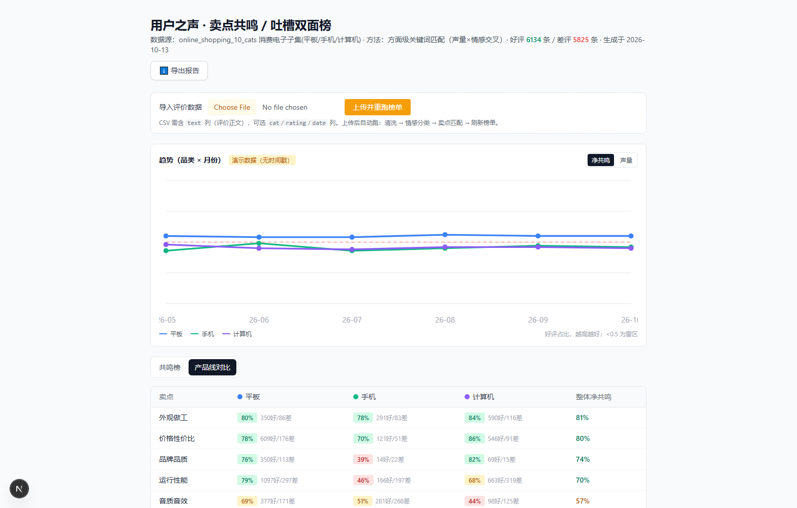

# VoC 用户之声 · 卖点共鸣榜

> 消费电子用户评价 → 情感分类 → **卖点共鸣榜**。
> GTM 团队看"用户真实认可我们产品的哪些卖点"，反哺内容策略；IPD 团队看"哪些卖点是雷区"，排改进优先级。

这是一个**方面级情感分析（ABSA）** 驱动的 VoC 产品：不只看"用户提到了什么"（声量），更看"用户是夸还是骂"（情感），把 16241 条真实电商评价交叉成**共鸣/吐槽双面榜**——单看声量榜看不到的洞察（屏幕声量第 2 但差评追平好评、续航 854 条差评是最大痛点），在这里一眼可见。

**市场及格线 4/4 全达成**（对标 $99/月 卖家工具 Helium10/Shulex 的 table stakes）：①可重复数据接入（CSV 上传自动重跑）②声量×情感交叉（共鸣/吐槽双面榜+净共鸣）③趋势（品类×月份净共鸣，无 date 用合成占位+诚实标注）④可导出报告（Markdown 一键下载）。

## 界面截图




## 核心能力

- **卖点共鸣双面榜**：10 个卖点维度（性能/价格/屏幕/外观/音质/手感/续航/拍照/品牌/散热）各拆好评声量（共鸣）、差评声量（吐槽）、净共鸣度（好评占比），绿/琥珀/红三色徽章一眼分清卖点与雷区。
- **卖点展开下钻**：点任一卖点看好评引文 vs 差评引文两栏对照 + 品类×净共鸣分层（如续航是全品类痛点，净共鸣 0.39）。
- **产品线对比矩阵**：卖点×品类净共鸣矩阵，横向看"同一卖点跨产品线的共鸣差异"（GTM 差异化内容），纵向看"某产品线的卖点 vs 雷区"（IPD 改进优先级）。
- **趋势卡**：品类×月份净共鸣/声量 SVG 折线，0.5 雷区参考线，悬停看单月数值；无时间戳数据用确定性合成占位 + 琥珀"演示数据"徽章，真实带 date 列的数据上传后自动变真。
- **可重复数据接入**：Web UI 上传 CSV（≤20MB）→ 进度条实时显示清洗→情感分类→卖点匹配→刷新榜单→自动刷新页面；也可命令行跑 `run_ingestion.py`。增量去重合并，情感分类断点续跑只跑新增。
- **可导出报告**：页头一键下载 Markdown 报告（下载前自动重跑确保最新），核心结论先行（主打卖点/改进雷区/爱恨参半/最大痛点/差评最多）+ 双面榜 + 品类矩阵 + 趋势 + 方法说明，可直接给老板/客户。

## 怎么跑（Quick Start）

前置：Python 3.13 + `uv`；Node 24；环境变量 `VOLCENGINE_API_KEYwinomp`（Ark key，情感分类用）。

```bash
# 1. Python 环境 + 依赖
cd apps/voc-analysis
uv venv
uv pip install --python .venv/Scripts/python.exe pandas pyarrow openai sentence-transformers scikit-learn jieba

# 2. 下载开源数据集（62773 条 parquet，7.5MB）
curl -L -o pipeline/data/osc_train.parquet \
  "https://huggingface.co/datasets/ttxy/online_shopping_10_cats/resolve/main/data/train-00000-of-00001.parquet"

# 3. 导出消费电子子集（16241 条）
.venv/Scripts/python.exe pipeline/export_ce_subset.py

# 4. LLM 情感分类（16241 条 ≈ 25min，断点续跑）
.venv/Scripts/python.exe pipeline/sentiment_classify.py

# 5. 卖点关键词匹配 + 双面榜导出 + 趋势 + 报告
.venv/Scripts/python.exe pipeline/match_selling_points_kw.py
.venv/Scripts/python.exe pipeline/export_sp_board.py
.venv/Scripts/python.exe pipeline/export_trend.py
.venv/Scripts/python.exe pipeline/export_report.py

# 6. Web UI
npm install
node node_modules/next/dist/bin/next dev -p 3010
# 打开 http://localhost:3010
```

**导入新评价数据**：榜单页顶部"导入评价数据"卡选 CSV（需含 `text` 列，可选 `cat`/`rating`/`date` 列）→ 上传并重跑；或命令行 `.venv/Scripts/python.exe pipeline/run_ingestion.py <job>`（CSV 放 `pipeline/data/uploads/`）。

## 怎么工作

```
原始评价 62773（开源 online_shopping_10_cats）
  → 消费电子子集 16241（平板/手机/计算机，清洗 BOM/过短/去重/截断）
  → LLM 情感分类（ark-code-latest，reasoning_effort=low，批量 8 并发）
      pos 6134 / neg 5825 / neu 2321 / unknown 1961
  → 方面级关键词匹配（10 卖点维度词表，pos + neg 双侧跑，多标签）
      每卖点：好评声量(共鸣) + 差评声量(吐槽) + 净共鸣度(好评占比)
  → 双面榜（共鸣/吐槽双侧声量 + 净共鸣 + 品类×净共鸣 + 双侧代表引文）
  → 趋势（品类×月份净共鸣，真实 date 优先 / 无 date 确定性合成占位+simulated 标注）
  → 报告（Markdown：核心结论 + 双面榜 + 品类矩阵 + 趋势 + 方法）
  → Next.js 读 sp_board_ui.json / trend_ui.json 渲染，/api/report 一键下载
```

**AI 在哪一步**：情感分类用 LLM（ark-code-latest，reasoning_effort=low 把单条 9.3s 降到 2.4s）；卖点归因用**关键词规则匹配**而非嵌入——这是经过两轮实测修正后的决策（见下"设计取舍"）。

## 设计取舍

**1. 为什么是关键词规则匹配，不是嵌入聚类（方法修正链，两轮实测修正）**

| 尝试 | 结果 | 失效根因 |
|---|---|---|
| HDBSCAN 密度聚类 | 738/800 条并成一坨大杂簇 | 真实评价在嵌入空间是连续高密度云，卖点差异是云内细微方向，不是密度分离的岛 |
| KMeans 硬划分（k=8） | 簇混合、一条夸多卖点只计一次 | 声量失真——真实评价常一条夸 3 个卖点 |
| 多标签嵌入匹配（BGE-M3） | 相似度挤 0.55-0.73 窄带，p50 分布重叠无法区分 | 消费电子评价共享大量语义（夸+产品词），嵌入把"夸屏幕"和"夸电池"映射过近，做不了卖点级区分 |
| **关键词规则匹配（采用）** | 可解释、零成本、声量真实 | 词表经真实词频校准（性能37%/价格26%/屏幕24%…），一条评价可命中多卖点，三卖点抽查命中引文精确 |

卖点是已知商业维度（屏幕/续航/散热/音质/价格），不需要"发现"——关键词直接命中"用户谈到了这个维度"，情感由评价整体 pos/neg 标签提供，声量×情感自然交叉。

**2. 核心结论判定逻辑：最大痛点 ≠ 差评绝对数**

报告里"最大痛点"= 净共鸣最低（差评占比最高，续航 0.39），不是差评绝对数——声量大的卖点差评数天然高（屏幕 1297 条差评是声量基数驱动，总提及 2632 排第 2），单列为"差评最多·先解决一致性再当卖点"，避免"差评数第一=最痛"的误判。

**3. 趋势：无时间戳数据诚实做趋势，绝不假装真数据**

osc 开源数据集无 date 字段（只 cat/text/label）。合成占位用**每条记录独立随机落月**（确定性 seed=42），不按记录顺序切块——osc 按品类聚块，顺序切会让品类只落某几个月、净共鸣伪波动。独立随机让每个品类全月份都有数据，趋势线=该品类净共鸣稳定平线，诚实表达"无时间维度"；UI 带琥珀"演示数据（无时间戳）"徽章，`trend_ui.json` 标 `simulated: true`。真实上传数据带 `date` 列，趋势自动用真实月份（支持 YYYY-MM-DD / YYYY-MM / 斜杠格式）。

**4. 情感分类前置过滤，不与卖点聚类并行**

卖点匹配只跑 pos 子集——否则"电池死机"问题簇会污染卖点榜（卖点=用户认可的正向维度，雷区由差评侧单独呈现为吐槽榜）。

## 效果/证据

**数据规模**：开源数据集 [`ttxy/online_shopping_10_cats`](https://huggingface.co/datasets/ttxy/online_shopping_10_cats)（62773 条真实电商评价，零抓取风险）→ 消费电子子集 16241 条 → 情感分类 pos 6134 / neg 5825 / neu 2321 / unknown 1961。

**双面榜结果**（净共鸣度 = 该卖点所有提及里好评的占比，>0.7 强共鸣 / 0.5-0.7 中性 / <0.5 雷区）：

| 卖点 | 好评(共鸣) | 差评(吐槽) | 净共鸣 | 解读 |
|---|---|---|---|---|
| 外观做工 | 1231 | 285 | **0.81** | 最强共鸣项 |
| 价格性价比 | 1276 | 318 | **0.80** | 强共鸣 |
| 品牌品质 | 433 | 150 | 0.74 | 净共鸣高 |
| 运行性能 | 1926 | 813 | 0.70 | 声量最大，仍偏正面 |
| 屏幕显示 | 1353 | 1297 | 0.51 | **爱恨参半**（差评几乎追平好评）|
| 音质音效 | 756 | 564 | 0.57 | 偏弱 |
| 手感体验 | 585 | 486 | 0.55 | 偏弱 |
| 散热温控 | 315 | 378 | 0.46 | **吐槽多于共鸣** |
| 拍照影像 | 371 | 480 | 0.44 | **吐槽多于共鸣** |
| 续航能力 | 536 | **854** | **0.39** | **最大痛点**（差评远超好评）|

**核心洞察**（单看声量榜看不出的）：
- **卖点（净共鸣 >0.7）**：外观做工、价格性价比、品牌品质 → GTM 主打这三个
- **雷区（净共鸣 <0.5）**：续航、拍照、散热 → IPD 改进优先级；续航 854 条差评是最大短板
- **屏幕显示爱恨参半**：声量第 2 但差评几乎追平好评，不能当卖点宣传，要先解决一致性
- **品类×净共鸣**：计算机整体偏正面（外观 0.84 / 价格 0.86 / 品牌 0.82）；手机是全品类问题区（散热 0.25 / 续航 0.34 / 品牌 0.39 / 运行性能 0.46）

**市场及格线验证**（对标 14 款成熟 VoC 产品调研，$99/月 卖家工具 table stakes）：
| 及格线 | 达成证据 |
|---|---|
| ①可重复数据接入 | CSV 上传 → 自动重跑 → 榜单/趋势/报告刷新，实测 16241→16249 增量合并 |
| ②声量×情感交叉 | 共鸣/吐槽双面榜 + 净共鸣度（ABSA 本义） |
| ③趋势 | 品类×月份净共鸣，osc 无 date 用合成占位+诚实标注，真实 date 自动变真 |
| ④可导出报告 | Markdown 一键下载（核心结论+双面榜+矩阵+趋势+方法，2239 字符 5 段全） |

**工程验证**：`next build` 通过（类型检查+静态预渲染）；SSR HTML 29530 字节 10 卖点全命中；数据接入全链路（POST 上传→status done→榜单刷新）curl 实测通过；报告下载链路 200 + 正确 content-type/disposition。dev/build 物理隔离（`.next` vs `.next-build`）修复了共用目录导致的 chunk 冲突。

## 局限 + 扩展

**诚实边界**：
- **数据含年代偏差**：手机品类多为功能机时代评价，差评偏多——品类×净共鸣的手机低分部分归因于此，不是当代手机产品的真实口碑。
- **单一品类混数据，无品牌维度**：当前数据集是平板/手机/计算机混合，无 brand 字段，竞品对比做不了——需多品牌数据到位后复用对比矩阵换维度。
- **关键词词表人工校准**：10 卖点词表经词频探测校准但仍人工维护，新品类（如手游外设）需补词表；换品类时管道全流程可复用，只需换 `ce_reviews.jsonl` 数据源。

**扩展方向（接口已留）**：
- **真实语料**：手游外设评价导出/抓取（带 date/brand 列）→ 上传 → 趋势自动用真实月份、品类维度可换品牌维度（管道与数据源解耦，CSV 上传接口已通）。
- **竞品对比**：多品牌/多产品数据到位后，对比矩阵的"品类"维度换成"品牌"即可复用。

## 3 分钟 Demo 流程

1. 打开榜单页 → 顶部看数据源/方法/好评差评数；讲"声量×情感交叉"（市场 ABSA 概念，共鸣必须分正负否则只是词频）
2. 讲方法修正链：为什么从嵌入聚类改成关键词匹配（两轮真实数据实测修正）
3. 指双面声量条 + 净共鸣徽章：一眼分清"卖点"（外观/价格 0.8+）vs"雷区"（续航/拍照/散热 <0.5）——这是单看声量榜看不出的
4. 点「续航能力」展开 → 好评引文 vs 差评引文两栏对照 + 品类×净共鸣（续航是全品类痛点，净共鸣 0.39）
5. 切「产品线对比」视图 → 卖点×品类净共鸣矩阵，指"手机是全品类问题区/计算机偏正面"（数据含年代偏差点名）
6. 指趋势卡 → 讲"无时间戳数据如何诚实做趋势"：合成占位+徽章标注，真实数据带 date 列自动变真；现场演示数据接入：上传一个 CSV → 进度条走完 → 榜单+趋势自动刷新
7. 点页头「⬇ 导出报告」→ 下载 Markdown 报告（核心结论先行+数据支撑），讲"GTM 标准交付物：从分析到给老板的成品一键到位"

## 目录

```
pipeline/
  export_ce_subset.py       # 消费电子子集导出（清洗）
  sentiment_classify.py     # LLM 情感分类（批量+并发+断点续跑）
  match_selling_points_kw.py# 卖点关键词多标签匹配（当前方法）
  export_sp_board.py        # 双面榜导出（含品类分层 + pos/neg 双侧）
  export_trend.py           # 趋势导出（真实 date 优先 / 合成占位+simulated 标注）
  export_report.py          # 报告导出（Markdown：核心结论+双面榜+矩阵+趋势+方法）
  run_ingestion.py          # 数据接入编排（CSV→jsonl→情感→卖点→榜单，状态机+增量去重）
  data/sp_board_ui.json     # 双面榜 UI 数据契约
  data/trend_ui.json        # 趋势 UI 数据契约（simulated 标注）
  data/report_latest.md     # 最新报告（下载前自动重跑刷新）
  # 方法修正链实证记录（保留备查）
  compare_cluster_algo.py   # HDBSCAN vs KMeans 对比
  cluster_selling_points.py # KMeans 硬划分（已弃用）
  match_selling_points.py   # 多标签嵌入匹配（已弃用，嵌入失效实证）
src/
  app/page.tsx              # 榜单页（读 sp_board_ui.json + trend_ui.json，页头导出报告按钮）
  app/api/report/route.ts   # 报告下载 API（GET，重跑 export_report 后返回 md 附件）
  app/api/ingest/           # 数据接入 API（上传≤20MB，detached 子进程 + 状态轮询）
  components/Board.tsx      # 交互双面榜（共鸣榜 ⇄ 产品线对比矩阵切换）
  components/TrendCard.tsx  # 趋势卡（品类×月份净共鸣/声量 SVG 折线 + simulated 徽章）
  components/IngestCard.tsx # 数据接入上传卡（进度条 + 完成自动刷新）
```
